  

  Nuxo is a crypto payment gateway for businesses. Take payments in 70+ assets on 40+ networks, 
  from Bitcoin and Lightning to Ethereum, Solana, Tron and TON, and see every one of them in one console.

  
  
  
  

 

### Four ways to take a payment

Send a [payment link](https://nuxo.io/solutions/payment-links), bill with an [invoice](https://nuxo.io/solutions/invoices),
add a [checkout](https://nuxo.io/solutions/hosted-checkouts) to your site, or turn any tablet into a
[register](https://nuxo.io/solutions/point-of-sale). Price in your own currency; pay a flat 1% on what you receive, with
no monthly fee ([pricing](https://nuxo.io/pricing)).

### For developers

One API, [signed webhooks](https://nuxo.io/developers/webhooks) you can trust, [SDKs](https://nuxo.io/developers/sdks)
and a [sandbox](https://nuxo.io/developers/sandbox) where nothing touches live money.

---

Nuxo is in closed beta: businesses apply on [nuxo.io](https://nuxo.io/closed-beta). Found a security problem? Tell us
through [our disclosure policy](https://nuxo.io/legal/security-disclosure).
